README
================

## Chapter 10 R for Data Science Exercises

#### Abby Nam, DS201

``` r
library(tidyverse)
```

    ## Warning: package 'ggplot2' was built under R version 4.5.2

    ## Warning: package 'tibble' was built under R version 4.5.2

    ## Warning: package 'tidyr' was built under R version 4.5.2

    ## Warning: package 'readr' was built under R version 4.5.2

    ## Warning: package 'purrr' was built under R version 4.5.2

    ## Warning: package 'dplyr' was built under R version 4.5.2

    ## Warning: package 'lubridate' was built under R version 4.5.2

    ## ── Attaching core tidyverse packages ──────────────────────── tidyverse 2.0.0 ──
    ## ✔ dplyr     1.2.1     ✔ readr     2.2.0
    ## ✔ forcats   1.0.1     ✔ stringr   1.5.1
    ## ✔ ggplot2   4.0.3     ✔ tibble    3.3.1
    ## ✔ lubridate 1.9.5     ✔ tidyr     1.3.2
    ## ✔ purrr     1.2.2     
    ## ── Conflicts ────────────────────────────────────────── tidyverse_conflicts() ──
    ## ✖ dplyr::filter() masks stats::filter()
    ## ✖ dplyr::lag()    masks stats::lag()
    ## ℹ Use the conflicted package (<http://conflicted.r-lib.org/>) to force all conflicts to become errors

``` r
library(ggplot2)
```

### Exercises 10.3.3

1.  Explore the distribution of each of the `x`, `y`, and `z` variables in `diamonds`. What do you learn? Think about a diamond and how you might decide which dimension is the length, width, and depth.

``` r
# run ?diamonds to learn about what the variables mean 
#visualizations of distributions 
ggplot(diamonds, aes(x = x)) +
  geom_histogram(binwidth = 0.5) +
  labs(
    x = "length (mm)",
    y = "count",
    title = "Distribution of diamond lengths"
  ) +
  coord_cartesian(xlim = c(0,10), ylim = c(0, 14000))
```

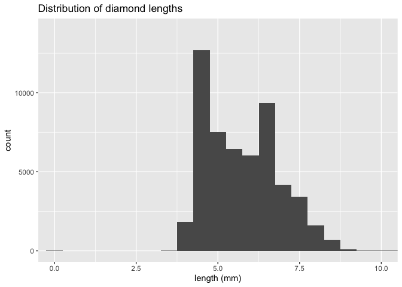<!-- -->

``` r
ggplot(diamonds, aes(x = x)) + 
  geom_histogram(binwidth = 0.5) +
  labs(
    x = "length (mm)",
    y = "count",
    title = "Distribution of diamond lengths"
  ) +
  coord_cartesian(ylim = c(0, 50))
```

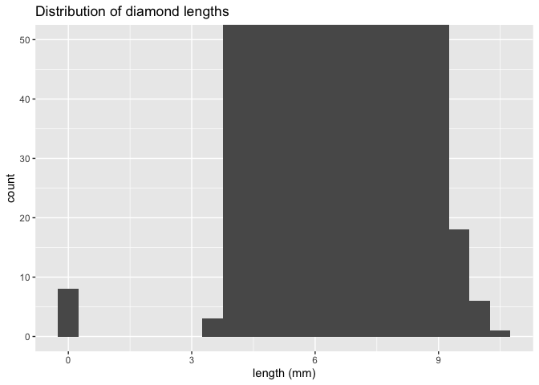<!-- -->

The histogram of diamond lengths (x) suggests that diamonds of approximately 4.5 mm and 6.5 mm lengths are the most common in this data set. Diamonds approximately 8.5 mm long and longer are rarer. There are about 8 diamonds in this dataset with a length of 0 mm, which may indicate missing data for this dimension.

``` r
ggplot(diamonds, aes(x = y)) +
  geom_histogram(binwidth = 0.5) +
  labs(
    x = "width (mm)",
    y = "count",
    title = "Distribution of diamond widths"
  ) +
  coord_cartesian(xlim = c(0,10), ylim = c(0, 14000))
```

<!-- -->

``` r
ggplot(diamonds, aes(x = y)) + 
  geom_histogram(binwidth = 0.5) +
  labs(
    x = "width (mm)",
    y = "count",
    title = "Distribution of diamond widths"
  ) +
  coord_cartesian(ylim = c(0, 50))
```

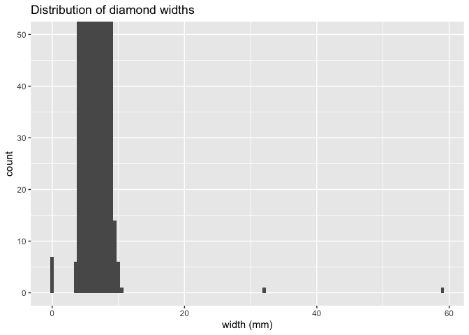<!-- -->

The histogram of diamond widths (y) suggests that diamonds of approximately 4.5 mm and 6.5 mm widths are the most common in this data set, around the same as the lengths. This is reasonable, considering that round-cut diamonds are supposed to be symmetrical. As seen with the lengths, diamonds approximately 8.5 mm wide or wider are rarer. Outliers are indicated by diamond widths of approximately 0 mm, 32 mm, and 58 mm. which may indicate missing data for this dimension or data entry errors (i.e., missing a decimal point). Diamonds 32 mm and 58 mm wide are possible but highly unlikely, considering the diamonds would be the size of a ping-pong ball and tennis ball respectively.

``` r
ggplot(diamonds, aes(x = z)) +
  geom_histogram(binwidth = 0.5) +
  labs(
    x = "depth (mm)",
    y = "count",
    title = "Distribution of diamond depths"
  ) +
  coord_cartesian(xlim = c(0,10), ylim = c(0, 14000))
```

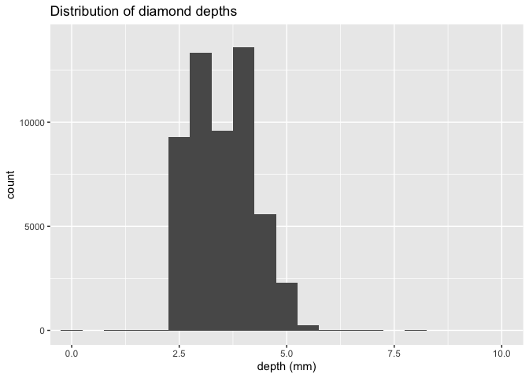<!-- -->

``` r
ggplot(diamonds, aes(x = z)) + 
  geom_histogram(binwidth = 0.5) +
  labs(
    x = "depth (mm)",
    y = "count",
    title = "Distribution of diamond depths"
  ) +
  coord_cartesian(ylim = c(0, 50))
```

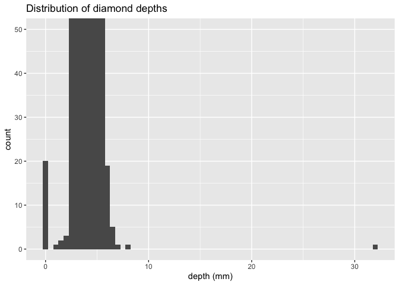<!-- -->

The histogram of diamond depths (z) suggests that diamonds of approximately 3.0 mm and 4.5 mm depths are the most common in this data set. Diamonds approximately 5.0 mm wide or wider are rarer. There were about 20 diamonds with a depth of 0 mm, which may indicate missing data for this dimension. There was also at least one diamond that had a depth of over 30 mm, which could be due to a data entry error. Otherwise, this diamond would have to be the size of a large golf ball to remain proportional to its width and length.

2.  Explore the distribution of `price`. Do you discover anything unusual or surprising? (Hint: Carefully think about the `binwidth` and make sure you try a wide range of values.)

``` r
ggplot(diamonds, aes(x = price)) +
  geom_histogram(binwidth = 150) +
  labs(
    x = "price (USD)",
    y = "count",
    title = "Distribution of diamond prices"
  ) 
```

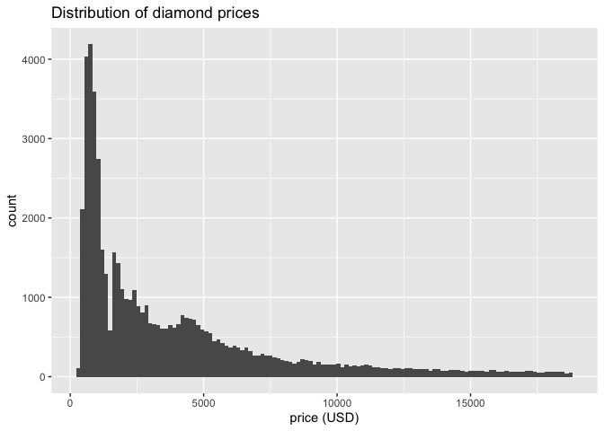<!-- -->

``` r
ggplot(diamonds, aes(x = price)) +
  geom_histogram(binwidth = 1) +
  labs(
    x = "price (USD)",
    y = "count",
    title = "Distribution of diamond prices"
  ) 
```

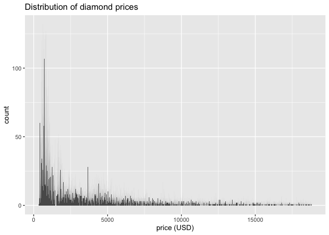<!-- -->

``` r
ggplot(data = diamonds, mapping = aes(x = price)) +
  geom_histogram(binwidth = 10, fill = "grey50") +
  # Zoom tightly around the $1,500 mark horizontally
  coord_cartesian(xlim = c(1200, 1800)) +
  labs(title = "Gap in diamond price distribution",
       x = "price (USD)", y = "count")
```

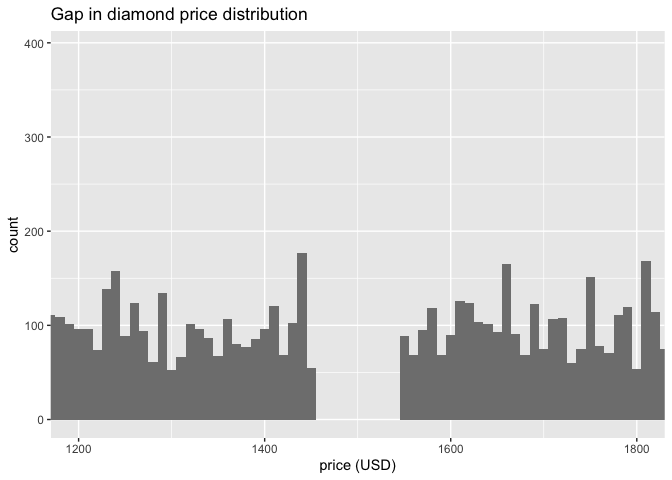<!-- -->

For the most part, the price distribution is as expected. Most diamonds in this data set are priced below \$2,500. Diamonds that are more expensive tend to be less common, resulting in a relatively positively skewed distribution of diamond prices. However, when setting the binwidth to 1 and then further zooming in on prices between \$1,200 and \$1,800, strangely, there are no diamonds priced at \$1,450 to \$1,550.

3.  How many diamonds are 0.99 carat? How many are 1 carat? What do you think is the cause of the difference?

``` r
diamonds |> 
  filter(carat %in% c(0.99, 1.00)) |> 
  count(carat, name = "Total Count")
```

    ## # A tibble: 2 × 2
    ##   carat `Total Count`
    ##   <dbl>         <int>
    ## 1  0.99            23
    ## 2  1             1558

There are significantly more 1 carat diamonds than 0.99 carat diamonds. I think that psychologically, a 1-carat diamond sounds more appealing and valuable than a 0.99 carat. Moreover, a 1 carat diamond could be marketed at a higher price than a 0.99 carat diamond because whole-carat weights are more profitable, even if the difference in the diamonds to the human eye is basically negligible.

4.  Compare and contrast [`coord_cartesian()`](https://ggplot2.tidyverse.org/reference/coord_cartesian.html) vs. [`xlim()`](https://ggplot2.tidyverse.org/reference/lims.html) or [`ylim()`](https://ggplot2.tidyverse.org/reference/lims.html)when zooming in on a histogram. What happens if you leave `binwidth`unset? What happens if you try and zoom so only half a bar shows?

``` r
ggplot(diamonds, aes(x = z)) +
  geom_histogram(binwidth = 0.5) +
  labs(
    x = "depth (mm)",
    y = "count",
    title = "Distribution of diamond depths, using coord_cartesian()"
  ) +
  coord_cartesian(xlim = c(0,10))
```

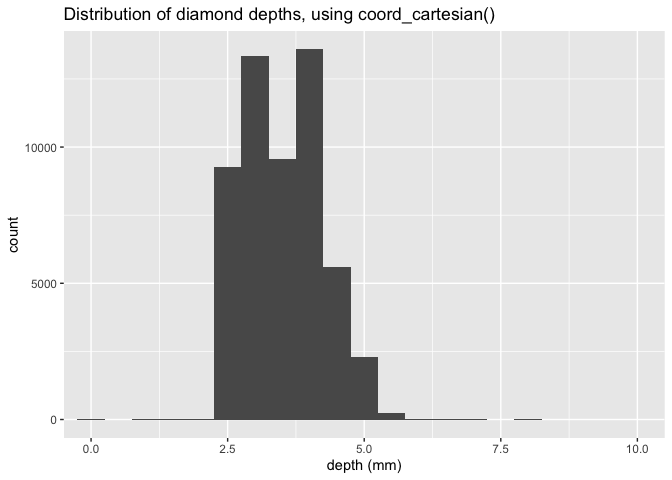<!-- -->

``` r
ggplot(diamonds, aes(x = z)) +
  geom_histogram(binwidth = 0.5) +
  labs(
    x = "depth (mm)",
    y = "count",
    title = "Distribution of diamond depths, zoomed in"
  ) + coord_cartesian(xlim = c(0,3))
```

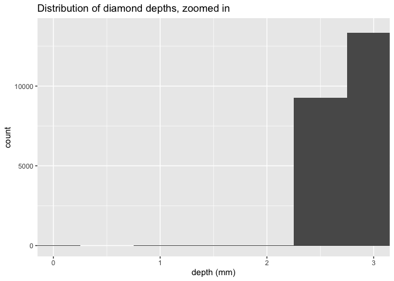<!-- -->

``` r
ggplot(diamonds, aes(x = z)) +
  geom_histogram(binwidth = 0.5) +
  labs(
    x = "depth (mm)",
    y = "count",
    title = "Distribution of diamond depths, using xlim()"
  ) + xlim(0, 10) 
```

    ## Warning: Removed 1 row containing non-finite outside the scale range
    ## (`stat_bin()`).

    ## Warning: Removed 2 rows containing missing values or values outside the scale range
    ## (`geom_bar()`).

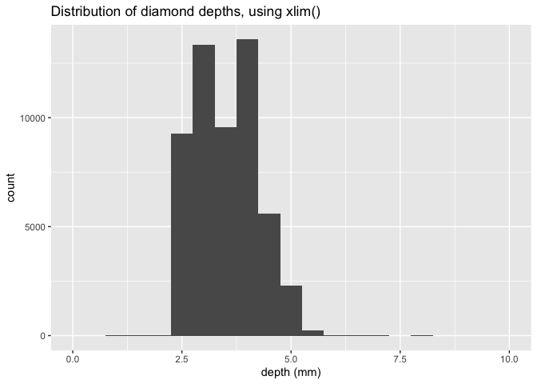<!-- -->

``` r
ggplot(diamonds, aes(x = z)) +
  geom_histogram() +
  labs(
    x = "depth (mm)",
    y = "count",
    title = "Distribution of diamond depths, no binwidth set"
  ) + xlim(0, 10) 
```

    ## `stat_bin()` using `bins = 30`. Pick better value `binwidth`.

    ## Warning: Removed 1 row containing non-finite outside the scale range
    ## (`stat_bin()`).

    ## Warning: Removed 2 rows containing missing values or values outside the scale range
    ## (`geom_bar()`).

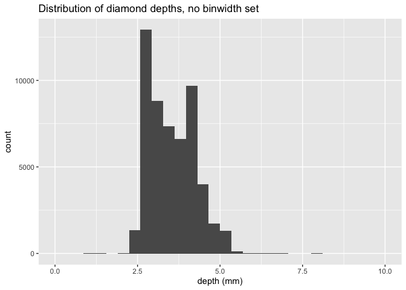<!-- -->

coord_cartesian() only zooms in on the specified x- and y- range, providing a narrower view of the data. Conversely, xlim() removed outliers and missing values before plotting the data as a histogram. Leaving binwidth unset led to the histogram being displayed with 30 bins. Zooming in so only half a bar shows with coord_cartesian(), naturally, led to a very narrow view of the data that cut off the rest of the distribution of the diamond depths (z) variable.

### Exercises 10.4.1

1.  What happens to missing values in a histogram? What happens to missing values in a bar chart? Why is there a difference in how missing values are handled in histograms and bar charts?

``` r
# replace the unusual values with NAs
diamonds2 <- diamonds |> 
  mutate(y = if_else(y < 3 | y > 20, NA, y))


ggplot(diamonds2, aes(x = y)) +
  geom_histogram() +
  labs(
    x = "width (mm)",
    y = "count",
    title = "Distribution of diamond widths"
  ) 
```

    ## `stat_bin()` using `bins = 30`. Pick better value `binwidth`.

    ## Warning: Removed 9 rows containing non-finite outside the scale range
    ## (`stat_bin()`).

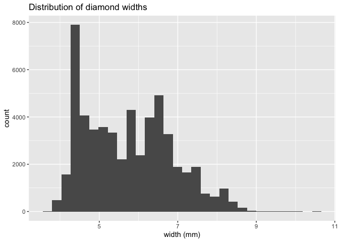<!-- -->

``` r
diamonds |> 
  mutate(color = if_else(runif(n()) < 0.1, NA_character_, as.character(color))) |> 
  ggplot() +
  geom_bar(mapping = aes(x = color)) +
  labs(
    x = "color",
    y = "count",
    title = "Counts of diamond color"
  ) 
```

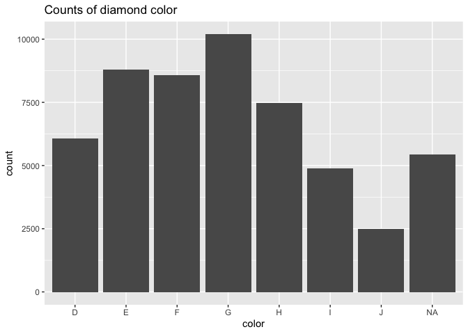<!-- -->

Missing values in a histogram are ignored and not plotted. In a bar chart, the missing values are accounted for in a separate bar from the other values. There is a difference in how the missing values are handled because a histogram plots the distribution of a continuous numeric variable. NA values cannot be put into a bin, so they do not show up in the chart. On the other hand, bar charts can plot categorical variables, so NA values are simply another category.

2.  What does `na.rm = TRUE` do in [`mean()`](https://rdrr.io/r/base/mean.html) and [`sum()`](https://rdrr.io/r/base/sum.html)?

``` r
test <- c(1, 2, 3, 4, 5, NA, NA)

mean(test)
```

    ## [1] NA

``` r
mean(test, na.rm = TRUE)
```

    ## [1] 3

``` r
sum(test)
```

    ## [1] NA

``` r
sum(test, na.rm = TRUE)
```

    ## [1] 15

na.rm = TRUE removes values coded as NA before calculating the mean and sum of the data. Otherwise, the mean and sum of data with NA values would return NA.

3.  Recreate the frequency plot of `scheduled_dep_time` colored by whether the flight was cancelled or not. Also facet by the `cancelled`variable. Experiment with different values of the `scales` variable in the faceting function to mitigate the effect of more non-cancelled flights than cancelled flights.

``` r
#?flights
nycflights13::flights |> 
  mutate(
    cancelled = is.na(dep_time),
    sched_hour = sched_dep_time %/% 100,
    sched_min = sched_dep_time %% 100,
    sched_dep_time = sched_hour + (sched_min / 60)
  ) |> 
  ggplot(aes(x = sched_dep_time)) + 
  geom_freqpoly(aes(color = cancelled), binwidth = 1/4)+
  facet_wrap(~ cancelled, scales = "fixed") +
  labs(
    x = "scheduled departure time (hour)",
    y = "number of flights",
    title = "Distribution of scheduled departure times, fixed scale"
  )
```

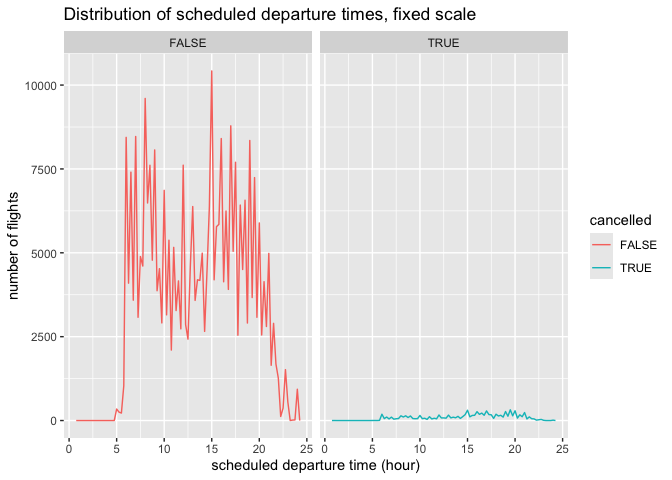<!-- -->

``` r
nycflights13::flights |> 
  mutate(
    cancelled = is.na(dep_time),
    sched_hour = sched_dep_time %/% 100,
    sched_min = sched_dep_time %% 100,
    sched_dep_time = sched_hour + (sched_min / 60)
  ) |> 
  ggplot(aes(x = sched_dep_time)) + 
  geom_freqpoly(aes(color = cancelled), binwidth = 1/4)+
  facet_wrap(~ cancelled, scales = "free_y") +
  labs(
    x = "scheduled departure time (hour)",
    y = "number of flights",
    title = "Distribution of scheduled departure times, free y scale"
  )
```

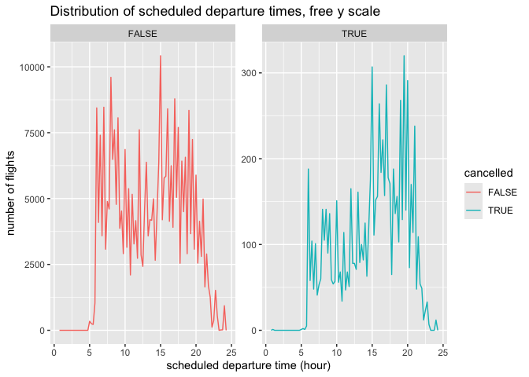<!-- -->

``` r
nycflights13::flights |> 
  mutate(
    cancelled = is.na(dep_time),
    sched_hour = sched_dep_time %/% 100,
    sched_min = sched_dep_time %% 100,
    sched_dep_time = sched_hour + (sched_min / 60)
  ) |> 
  ggplot(aes(x = sched_dep_time)) + 
  geom_freqpoly(aes(color = cancelled), binwidth = 1/4)+
  facet_wrap(~ cancelled, scales = "free") +
  labs(
    x = "scheduled departure time (hour)",
    y = "number of flights",
    title = "Distribution of scheduled departure times, free scale"
  )
```

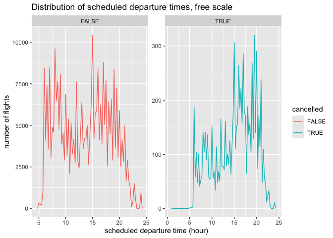<!-- -->

Testing fixed, free_y, and free leads to differences in how the cancelled flights and flights that occurred are depicted in the graphs. The fixed scale retains the same x and y scales for both the cancelled and not cancelled flights, which is good for consistency but obscures the patterns in the cancelled flights due to how many non-cancelled flights there were. The free_y scale retains the same x-axis scale, but allows for separate y-axis scales, providing a more detailed view of both distributions, with the caveat that they are not on the same y-axis. Finally, free scale gives both graphs their own x- and y-axis scales, as seen by the final figure.
